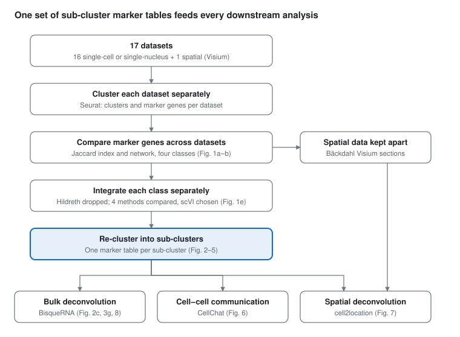

# Reading notes: the human white adipose tissue single-cell and spatial atlas

Study notes on one paper and its code, written figure by figure. For every analysis figure the notes answer the same five questions: which data went in, how the result was computed, what a worked example looks like, what the authors conclude, and where the evidence stops.

- **Paper:** Massier L. et al., *An integrated single cell and spatial transcriptomic map of human white adipose tissue*, Nature Communications 14, 1438 (2023). <https://www.nature.com/articles/s41467-023-36983-2>
- **Authors' code:** <https://github.com/lmassier/hWAT_singlecell>

These are personal notes. They are not written or endorsed by the authors of the paper.

## Bottom line

The paper pools 17 single-cell, single-nucleus and spatial transcriptomic datasets of human white adipose tissue (WAT) into one shared set of sub-cluster names and marker gene tables, more than 60 sub-clusters in all. It then uses those marker tables to study cell–cell communication, spatial location and clinical data from 864 people.

| # | Claim | Figure | Chapter |
|---|---|---|---|
| 1 | Apart from one dataset (Hildreth), clusters from different studies match each other and fall into four classes: adipocytes, FAPs (fibroblast and adipogenic progenitors), vascular cells and immune cells | 1a–b | [01](docs/01-fig1ab-jaccard-network.md) |
| 2 | Immune, vascular and FAP cells give stable sub-clusters after integration | 1e, 2–4 | [02](docs/02-fig1cde-integration-benchmark.md), [03](docs/03-fig2-3-immune-vascular.md) |
| 3 | Subcutaneous FAPs follow two routes, one of them adipogenic | 4d–g | [04](docs/04-fig4-fap-pseudotime.md) |
| 4 | Adipocytes do not give stable sub-clusters, and the paper points to platform bias in single-nucleus sequencing | 5 | [05](docs/05-fig5-adipocytes.md) |
| 5 | FAPs mainly send signals and M2-like macrophages mainly receive them | 6 | [06](docs/06-fig6-cell-communication.md) |
| 6 | FAP sub-clusters sit in different places in the tissue | 7 | [07](docs/07-fig7-spatial.md) |
| 7 | Sub-cluster scores track metabolic measures and change with weight loss | 8 | [08](docs/08-fig8-clinical.md) |

## Pipeline

One main line with three downstream branches. Almost everything downstream passes through one interface: the marker table of each sub-cluster.

Two side notes on the diagram:

- The spatial dataset takes part in the Jaccard comparison (Fig. 1a) and then leaves the main line. It returns only as the target of spatial deconvolution.
- Adipocytes failed to integrate and were pooled into one class ([chapter 05](docs/05-fig5-adipocytes.md)).

## The 17 datasets

The network script labels the datasets A to Q. Depot and method come from the source data of Fig. 1c–d, subjects and objects from the source data of Fig. 1a, and the median Jaccard value is computed from `Figure_1a_Jaccard.txt` (explained in [chapter 01](docs/01-fig1ab-jaccard-network.md)).

| Letter | Dataset | Depot | Method | Subjects | Objects | Clusters | Median Jaccard |
|---|---|---|---|---|---|---|---|
| A | Vijay et al. | sc | scSeq | 13 | 13,449 | 27 | 0.273 |
| B | Vijay et al. | om | scSeq | 12 | 12,899 | 26 | 0.258 |
| C | Jaitin et al. | om | scSeq | 1 | 12,065 | 26 | 0.260 |
| D | Merrick et al. | sc | not listed | 1 | 11,335 | 23 | 0.192 |
| E | Karunakaran et al. | sc | not listed | 2 | 2,223 | 15 | 0.224 |
| F | Acosta et al. | sc | scSeq | 4 | 915 | 8 | 0.186 |
| G | Hildreth et al. | sc | scSeq | 6 | 83,546 | 25 | 0.038 |
| H | Sun et al. | sc | snSeq | 5 | 4,885 | 12 | 0.230 |
| I | Angueira et al. | pvat | snSeq | 3 | 25,196 | 24 | 0.346 |
| J | Massier et al. #1 | sc | snSeq | 10 | 10,834 | 24 | 0.356 |
| K | Massier et al. #2 | sc | snSeq | 2 | 6,435 | 25 | 0.374 |
| L | Massier et al. #4 | om | snSeq | 5 | 15,102 | 25 | 0.209 |
| M | Emont et al. | om | snSeq | 10 | 81,395 | 37 | 0.392 |
| N | Emont et al. | sc | snSeq | 9 | 56,169 | 36 | 0.399 |
| O | Emont et al. | sc | scSeq | 9 | 28,464 | 30 | 0.274 |
| P | Massier et al. #3 | sc | snSeq | 1 | 8,471 | 15 | 0.291 |
| Q | Bäckdahl et al. | sc | spatial (Visium) | 10 | 27,937 spots | 19 | 0.162 |
| | **Total** | | | | **401,320** | **397** | |

Depot labels: `sc` subcutaneous, `om` omental, `pvat` perivascular. Method labels: `scSeq` single-cell, `snSeq` single-nucleus. "Not listed" means the dataset does not appear in the Fig. 1c–d source file. Massier #1 to #4 are the datasets generated for this paper. See the [glossary](docs/10-glossary.md) for all abbreviations.

**One number to get straight.** The 401,320 objects in the abstract include the 27,937 spatial spots and the 83,546 Hildreth cells that were later excluded. At most 401,320 − 27,937 − 83,546 = 289,837 sn/sc cells entered integration, and each dataset was capped to a similar size after that.

## Figure, script, code availability

Script paths are relative to the root of the authors' repository.

| Figure | Script | Code in the repository |
|---|---|---|
| 1a (Jaccard column), 1b | `scripts/Network/Jaccard_and_Network_Fig1.R` | Yes |
| 1c, 1d | None | No |
| 1e | `scripts/Integration/` (5 scripts) | Integration only. The code for the three metrics is missing |
| 2a, 2b, 2d–f, 6c | `scripts/Cell_Types/Immune_Cells.R` | Yes |
| 2c, 2g, 3g | `scripts/Bulk_deconvolution/Deconvolution_Depots.R` | Yes. Statistical tests missing |
| 3a, 3b, 3f | `scripts/Cell_Types/Vascular_Cells.R` | Yes |
| 4a, 4b, 4d, 4i | `scripts/Cell_Types/FAP_MSL.R` | Yes |
| 4h | `scripts/Cell_Types/FAP_compare_with_Dong_etal.R` | Yes |
| 4j | `scripts/Cell_Types/FAP_comparisons.R` | Yes |
| 4g | None | No |
| 5 | None | No |
| 6a, 6b, 6d, 6e | `scripts/Cell_Cell_Communications.R` | Yes |
| 7a, 7c, 7d | `scripts/Spatial_Deconvolution/` | Yes |
| 8 | None | No |

Per-dataset preprocessing (Seurat 4.1: SCTransform, ICA, Harmony for subject, clustering, markers) is said in Methods to be on GitHub, but the repository has no script for it.

## Chapters

| # | Chapter | Questions it answers |
|---|---|---|
| 01 | [Fig. 1a–b: Jaccard index and marker network](docs/01-fig1ab-jaccard-network.md) | Is every cluster compared with every other? How does one index per dataset come out? What do node size, colour and edges mean? Are edges thresholded? |
| 02 | [Fig. 1c–e: composition and integration benchmark](docs/02-fig1cde-integration-benchmark.md) | Does integration use all the data? Were cells annotated first? How are ARI, LISI and kBET computed, and from what? |
| 03 | [Fig. 2–3: immune and vascular cells](docs/03-fig2-3-immune-vascular.md) | How are sub-clusters made? How are depot differences shown and checked? |
| 04 | [Fig. 4: FAPs and pseudotime](docs/04-fig4-fap-pseudotime.md) | What does pseudotime conclude? Did the experiments confirm it? What do panels 4h–k add? |
| 05 | [Fig. 5: adipocytes](docs/05-fig5-adipocytes.md) | Why can adipocytes not be subtyped from snSeq? |
| 06 | [Fig. 6: cell–cell communication](docs/06-fig6-cell-communication.md) | Is every combination explored? How does "FAPs send, M2 receive" come out? |
| 07 | [Fig. 7: spatial deconvolution](docs/07-fig7-spatial.md) | Is the reference the integrated data? What are the two levels of detail? How is co-localisation computed? |
| 08 | [Fig. 8: clinical associations](docs/08-fig8-clinical.md) | How is bulk deconvolution done? What is concluded? |
| 09 | [Evidence, reproducibility, takeaways](docs/09-evidence-and-reproducibility.md) | Which choices carry the paper? What breaks if you rerun the repository? What is still open? |
| 10 | [Glossary](docs/10-glossary.md) | Abbreviations, cell-type names and tools |

## What was read

- **Read:** the main text, all main-figure legends, Methods, every script under `scripts/`, and the structure and some values of `Source Data/`.
- **Not read:** the Supplementary PDF (supplementary figures, tables and data). Statements about supplementary figures rest on the main text and the code only.
- "Not in the paper" or "not in the repository" means not found within that scope. It does not mean the authors did not do it.

## Conventions

- Examples marked **illustrative** use made-up numbers to show how a calculation works. All other numbers come from the paper or its source data.
- Code blocks are short excerpts from the authors' scripts, sometimes condensed. Line references (for example L1850) point into the authors' files.
- Cluster names follow the paper: `lyC` lymphoid, `myC` myeloid, `vC` vascular, `sfC` subcutaneous FAP, `ofC` omental FAP.

## Sources and reuse

The paper is open access under a Creative Commons Attribution 4.0 licence. The code excerpts quoted here belong to the authors of the paper, and their repository carries no licence file. No figure from the paper is reproduced in these notes.
